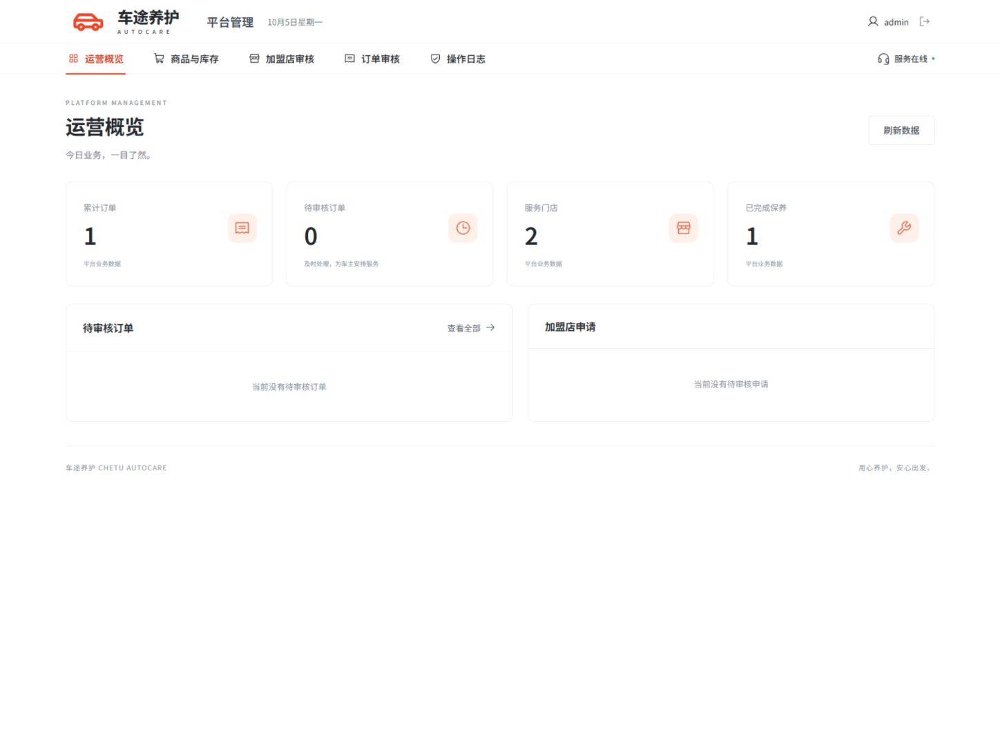

# 汽车保养平台

基于 Spring Boot、Vue 3 和 MySQL 开发的汽车保养服务平台。车主、平台管理员和加盟店使用不同工作台，完成配件选购、订单审核、预约、扫码到店、凭据核销和保养留档。

## 界面展示

配件商城：


管理员工作台：



## 首次运行

环境要求：JDK 17、Maven、Node.js（建议 22 LTS）、MySQL 8.0.16 或更新版本。确保 `java`、`mvn`、`npm`、`mysql` 在 PATH 中可用，且 MySQL 服务已启动。

```powershell
git clone https://github.com/ssshwe/car-maintenance-platform.git
cd car-maintenance-platform

# 输入本机 MySQL 管理员密码，生成独立数据库、专用账号和 .env
.\scripts\setup-mysql.ps1

# 构建前端、运行后端测试并启动
.\scripts\start.ps1 -Build
```

启动后访问 <http://localhost:8080>，使用下方演示账号体验完整流程。`.env`、运行日志、依赖和构建产物不包含在仓库中，需要在本机生成。

## 本机运行

完成首次配置后，本地 `.env` 保存专用数据库账号、密码和 JWT 密钥，未保存 root 密码，且已加入 `.gitignore`。专用账号只能操作本项目数据库。

直接双击项目根目录的 **一键启动.bat**，脚本会检查 MySQL、启动项目，等待服务就绪后打开浏览器。项目已经运行时会复用当前进程，不会重复启动。如果 MySQL 服务未运行，脚本会尝试启动本机唯一的 MySQL 服务；权限不足时会提示以管理员身份运行。

关闭项目时双击 **一键停止.bat**，会停止本项目的后台 Java 服务，MySQL 服务和已保存的数据会保留。只关闭网页或启动窗口，后台项目仍会运行。开发时手动运行的 Vite 前端服务，需要在它的终端按 `Ctrl+C` 停止。

在项目根目录打开 PowerShell：

```powershell
# 已构建时直接启动
.\scripts\start.ps1

# 修改源码后，重新构建并启动
.\scripts\stop.ps1
.\scripts\start.ps1 -Build

# 停止本项目
.\scripts\stop.ps1
```

访问 <http://localhost:8080>。前端已打包进 Spring Boot JAR，不需要分别启动前后端。运行日志位于 `logs/app.log` 和 `logs/app-error.log`。

| 角色 | 登录名 | 本地演示密码 |
| --- | --- | --- |
| 车主 | customer | User@123 |
| 平台管理员 | admin | Admin@123 |
| 龙子湖店 | store | Store@123 |
| 金水店 | store2 | Store@123 |

登录弹窗中的演示按钮可以填入以上账号。也可以自行注册车主或加盟店。加盟店注册后，需要平台管理员审核通过才能登录。

## 演示业务流程

1. 车主登录，选购配件加入购物车，选择服务门店后提交订单。
2. 管理员登录，进入订单审核，查看配件和金额，点击“通过并配送”。系统扣减库存，并为订单生成十位数字凭据。
3. 车主登录，在“我的订单”预约日期和时段，并查看到店凭据。
4. 门店登录，进入“到店核验”，展示门店二维码。车主在预约当天扫码、登录本人账号并输入凭据登记。门店人员输入同一凭据，核验后点击“核销凭据并开始服务”。
5. 门店在“保养服务”填写完成项目和备注。车主在“保养记录”查看结果，并可以评价商品或门店。

预约日期严格校验为当天才能登记和核销。如果演示时间已经超出默认的 09:00–12:00、14:00–18:00，门店可以在“时段管理”新增当天尚未结束的时段。新审核通过的门店默认开放未来14天、每天两个时段。

### 手机扫码

电脑和手机连接同一局域网。在终端运行 `ipconfig`，找到正在使用的网卡 IPv4 地址，例如 `192.168.1.100`。在门店“到店核验”页面将“手机可访问的前端地址”填写为 `http://192.168.1.100:8080`，点击更新二维码。手机使用浏览器或微信扫码打开页面。Windows 防火墙需要允许 Java 的本地网络访问；本项目不自动修改防火墙。

扫码登记使用车主账号，工作人员核销使用门店账号。凭据只适用于订单指定门店，并且只能核销一次。

## 已实现功能

- 车主注册、登录；加盟店注册、通过/拒绝审核；BCrypt 密码摘要和 JWT 认证。
- 商品新增、编辑、上架、下架与逻辑删除，商品价格和单位保养工时费分别维护。
- 搜索与分类浏览、库存显示、购物车合并和数量调整、选择门店下单。
- 服务端重新计价，保存商品名称、编码和费用快照。
- 下单原子预占库存，拒绝释放预占，通过扣减现存和预占库存。
- 十位数字凭据、门店时段及容量管理、预约、车主扫码登记。
- 门店凭据核验、开始服务、完成保养；车主查询订单及保养记录。
- 完成订单后评价商品或门店；公开查看评价。
- 管理员业务概览和审计日志；分页；手机和桌面界面。

按任务书简化物流：审核通过即视为送达门店；凭据在订单页面显示。不接真实支付、短信、微信通知或真实物流服务。支付属于可选项，本版本未接入。

## 技术与源码

Java 17、Spring Boot 3.5.6、MyBatis-Plus 3.5.12、MySQL、Vue 3、Vite。界面采用横向导航、红黑养护主视觉和白色商品商城；使用本地 Noto Sans SC 可变字体、Phosphor 图标、WebP 配件图片与二维码组件，无外部 CDN 依赖。首页、购物车、订单及三种角色工作台均支持手机浏览。

```text
backend/src/main/java/com/example/maintenance/
  api/             REST控制器与输入校验DTO
  auth/            JWT、当前账号、限流
  common/          统一响应与异常处理
  config/          认证拦截器、时间字段填充、初始化数据
  entity/          数据库实体
  mapper/          MyBatis-Plus数据访问与行锁查询
  service/         事务、库存、订单、预约、核销等业务
backend/src/main/resources/schema.sql    13张表的建表SQL
backend/src/test/.../BusinessFlowTest.java 自动化集成测试
frontend/src/App.vue                    三种角色的交互界面
frontend/src/style.css                  响应式样式
frontend/src/redesign.css               新版商城与工作台主题
frontend/public/assets/redesign/        养护主视觉和商品图片
scripts/                               配置、构建、启动、停止、MySQL测试
```

库存和时段容量使用带条件的 UPDATE，并检查受影响行数。订单审核、开始服务和完工操作使用行锁，在一个事务中更新相关记录。数据库唯一键保证账号、购物车行、预约、凭据和保养记录不重复。历史订单使用 `BigDecimal` 金额与商品快照；商品修改不改变历史金额。

接口前缀 `/api/v1`，认证使用 `Authorization: Bearer <token>`。成功返回 `code/message/data/traceId`；分页 `data` 包含 `records/page/size/total`。健康检查：`GET /actuator/health`。

## 开发与测试

```powershell
# 构建前端、运行后端自动化测试，并生成可运行JAR
.\scripts\build.ps1

# 在独立的临时MySQL库中运行测试；提示输入root密码
# 不使用或清空业务库，测试结束后只删除本次临时测试库与账号
.\scripts\test-mysql.ps1

# 前端开发：先启动后端，再运行Vite
cd frontend
npm.cmd ci
npm.cmd run dev
```

前端开发地址为 `http://localhost:5173`，代理到后端 `8080`。如果修改后端端口，需同步修改 `frontend/vite.config.js` 的开发代理。正式打包运行不需要此代理。

自动化测试涵盖完整保养流程、重复账号、加盟审核、重新计价与快照、多商品下单回滚、拒绝释放库存、审批失败回滚、跨店与重复核销、重复与跨店预约、角色及订单归属、过期日期、库存调整、逻辑删除、最后一件库存并发、最后一个预约名额并发和非法输入。测试默认使用独立内存数据库，也可通过脚本在本机 MySQL 运行。

## 在另一台电脑配置

安装 JDK 17、Maven、Node.js 和 MySQL 8.0.16 或更新版本。在项目根目录运行：

```powershell
.\scripts\setup-mysql.ps1
.\scripts\start.ps1 -Build
```

初始化脚本创建全新数据库和随机专用账号。如果发现同名数据库已经存在，则自动换名；不会覆盖已有库或已有 `.env`。SQL 建表使用 `CREATE TABLE IF NOT EXISTS`，启动不会删除业务数据。首个空数据库会初始化本地演示账号、配件与门店，以后启动只补充未来默认时段。

`.env` 和日志包含本机配置，不能作为源码提交材料公开。更换环境应重新运行初始化脚本生成本地连接配置。关闭初始化示例可将 `.env` 中 `APP_SEED` 改为 `false`。
